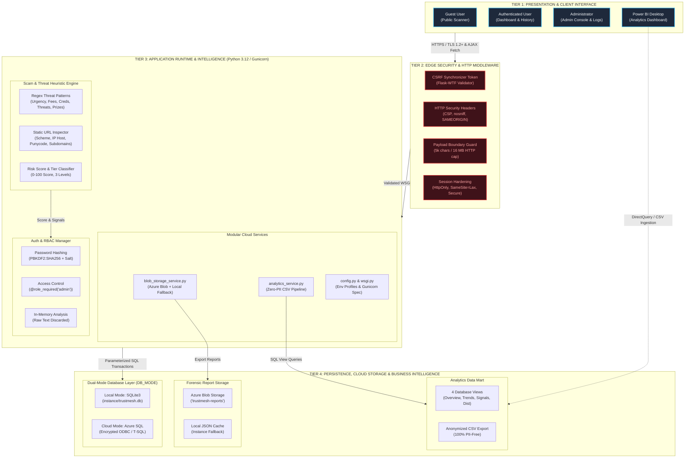
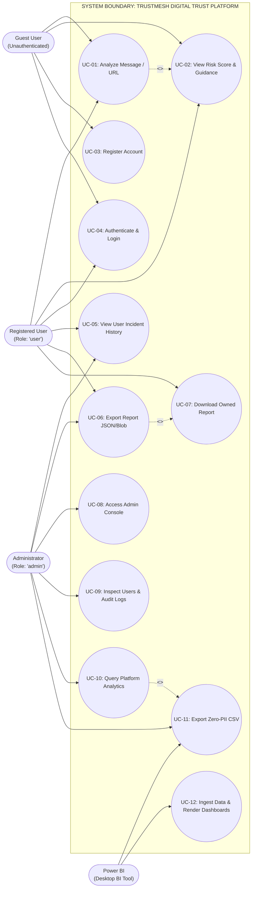
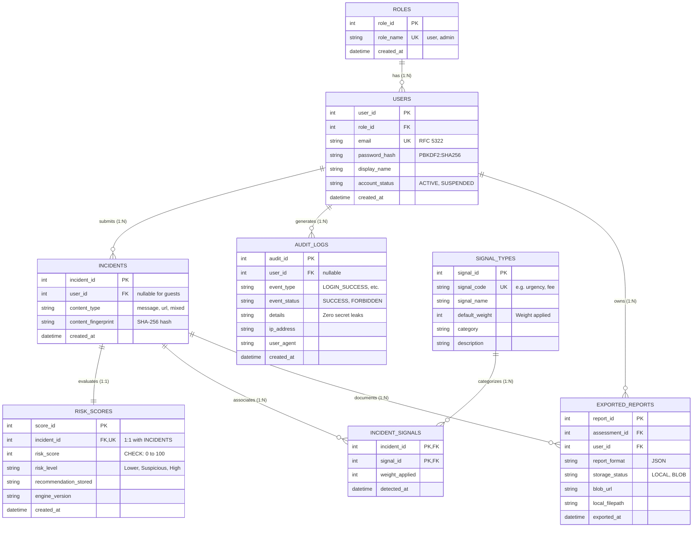
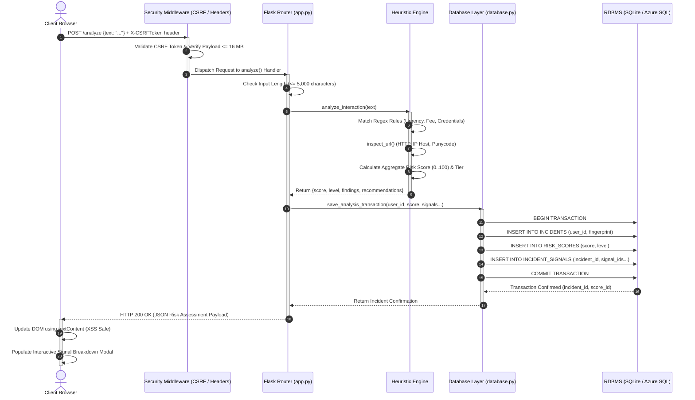

# TRUSTMESH — SYSTEM DIAGRAMS & VISUAL DOCUMENTATION
**AI-Powered Personal Digital Trust & Scam Intelligence Platform**  
**Phase 5, Task 2: Architectural Schematics, UML Modeling & Data Engineering Blueprints**  
**Generated:** November 11, 2026 | **Format:** Dual-Format (Vector SVG + Standard GitHub Mermaid.js)  
**Location of Vector Files:** [`Diagrams/`](file:///c:/Users/simran/OneDrive/Desktop/TRUST%20MESH/Diagrams)

---

## 1. Overview of System Visual Specifications

This document catalogs the complete visual engineering specifications for the **TRUSTMESH** platform. Six dedicated diagrams have been engineered to model the system from multiple perspectives: high-level layered architecture, functional use-case boundaries, data flow lifecycles (Level 0 Context and Level 1 Subsystem Decomposition), 3NF relational data schema, and request-response runtime execution sequence.

Each diagram is provided in two production formats:
1. **High-Resolution Vector SVG:** Crisp, scalable vector artwork located in the [`Diagrams/`](file:///c:/Users/simran/OneDrive/Desktop/TRUST%20MESH/Diagrams) directory, styled in the TRUSTMESH dark cybersecurity theme (`#070B14`, `#00F090`, `#38BDF8`), ready for direct inclusion into thesis documents, Word (`.docx`), PDF reports, and slides.
2. **Mermaid.js Code Blocks:** Native, interactive diagrams that render in GitHub, VS Code, and standard markdown viewers.

---

## 2. Diagram 1: High-Level System Architecture (4-Tier Model)

### 2.1 Technical Purpose
Illustrates the logical separation of concerns across the four primary tiers of TRUSTMESH:
- **Tier 1 (Presentation & Client Interface):** Public guests, authenticated users, administrators, and external BI tools.
- **Tier 2 (Edge Security & HTTP Middleware):** CSRF token validation, security headers, request boundaries, and error masking.
- **Tier 3 (Application Runtime & Core Intelligence):** Heuristic engine, static URL parser, authentication/RBAC manager, and decoupled cloud services.
- **Tier 4 (Persistence, Cloud Storage & Analytics):** Dual-mode database layer (SQLite / Azure SQL), hybrid forensic report storage (Azure Blob / Local), and the Power BI analytics mart.

### 2.2 Visual Vector Schematic
> Vector File: [`Diagrams/01_system_architecture.svg`](file:///c:/Users/simran/OneDrive/Desktop/TRUST%20MESH/Diagrams/01_system_architecture.svg)

### 2.3 Mermaid.js Specification


### 2.4 Viva Examination Defense Talking Points
- **Question:** *Why did you adopt a 4-tier architecture instead of a traditional 2-tier client-server model?*
- **Answer:** *"A 4-tier model strictly decouples the client interface, edge security enforcement, business intelligence logic, and persistence layers. This enforces the Single Responsibility Principle (SRP), enables independent scaling of application workers via Gunicorn WSGI, prevents direct client database access, and allows zero-cost local operation while maintaining full cloud readiness for Azure App Service and Azure SQL."*

---

## 3. Diagram 2: UML Use Case Diagram

### 3.1 Technical Purpose
Formally models system actor boundaries and operational capabilities:
- **Actors:**
  - `Guest User`: Unauthenticated visitor performing ephemeral scans and registering accounts.
  - `Registered User`: Authenticated user with role `user` managing personal history and report exports.
  - `Administrator`: Privileged operator with role `admin` managing users, security audit logs, and threat telemetry.
  - `Power BI Desktop`: External analytical tool ingesting anonymized threat intelligence.
- **Use Cases:** 12 discrete use cases covering core scanning, explainable security, authentication, privacy-preserving storage, report export, administrative governance, and business intelligence.

### 3.2 Visual Vector Schematic
> Vector File: [`Diagrams/02_use_case_diagram.svg`](file:///c:/Users/simran/OneDrive/Desktop/TRUST%20MESH/Diagrams/02_use_case_diagram.svg)

### 3.3 Mermaid.js Specification


### 3.4 Viva Examination Defense Talking Points
- **Question:** *How does your Use Case model prevent unauthorized access to administrative functions?*
- **Answer:** *"Use cases UC-08 through UC-11 are strictly bounded by backend Role-Based Access Control. While the client UI conditionally hides administrative links, the Flask server enforces `@role_required('admin')` on every administrative route. If a standard user attempts to trigger UC-08, the request is intercepted with HTTP 403 Forbidden and permanently recorded in the `AUDIT_LOGS` table."*

---

## 4. Diagram 3: Data Flow Diagram (Level 0 — Context Diagram)

### 4.1 Technical Purpose
Defines the highest abstraction level of TRUSTMESH, treating the application as a single process (`0.0`) and illustrating external entities, input data streams, and output deliverables.

### 4.2 Visual Vector Schematic
> Vector File: [`Diagrams/03_dfd_level_0_context.svg`](file:///c:/Users/simran/OneDrive/Desktop/TRUST%20MESH/Diagrams/03_dfd_level_0_context.svg)

### 4.3 Mermaid.js Specification
```mermaid
flowchart TD
    EndUser["END USER\n(Guest & Authenticated Web Client)"]
    Admin["ADMINISTRATOR\n(Security Operations)"]
    Process["PROCESS 0.0\nTRUSTMESH PLATFORM\nDigital Trust & Scam Intelligence System"]
    PowerBI["POWER BI DESKTOP\n(Visual Analytics Tool)"]
    Azure["MICROSOFT AZURE\n(SQL Database & Blob Storage)"]

    %% User Flows
    EndUser -->|1. Raw Text / URL, Auth Credentials, Export Requests| Process
    Process -->|2. Risk Score (0-100), Findings, Session Cookie, Forensic Reports| EndUser

    %% Admin Flows
    Admin -->|3. Administrative Auth, User Management, Audit Queries| Process
    Process -->|4. Real-Time Audit Event Stream, System KPIs, User Directory| Admin

    %% Analytics Flows
    Process -->|5. Sanitized, Anonymized Assessment CSV Telemetry| PowerBI

    %% Cloud Flows
    Process -->|6. Encrypted T-SQL Queries, Private Blob Uploads| Azure
    Azure -->|7. Query Result Sets, Blob Retrieval Acknowledgements| Process
```

### 4.4 Viva Examination Defense Talking Points
- **Question:** *What is the fundamental difference between data flow to the End User versus data flow to Power BI?*
- **Answer:** *"Data flow to the End User includes personalized, interactive scoring and forensic incident reports scoped strictly to their authenticated identity. Conversely, the data flow to Power BI is completely scrubbed of personal identifiers—names, email addresses, IP addresses, and message text are stripped at process boundaries, transmitting purely statistical threat metadata."*

---

## 5. Diagram 4: Data Flow Diagram (Level 1 — Subsystem Decomposition)

### 5.1 Technical Purpose
Deconstructs Process `0.0` into six core sub-processes and maps how data moves between processes and persistent database stores.

### 5.2 Visual Vector Schematic
> Vector File: [`Diagrams/04_dfd_level_1_decomposition.svg`](file:///c:/Users/simran/OneDrive/Desktop/TRUST%20MESH/Diagrams/04_dfd_level_1_decomposition.svg)

### 5.3 Mermaid.js Specification
```mermaid
flowchart TD
    subgraph Processes["SUB-PROCESSES"]
        P1["1.0 Auth & Access Control\n(Salting, RBAC, Sessions)"]
        P2["2.0 Threat Heuristic Engine\n(Regex, URL Parser, Scoring)"]
        P3["3.0 Persistence Controller\n(Fingerprinting, ACID Transactions)"]
        P4["4.0 Audit Logging Manager\n(Event Telemetry, Violations)"]
        P5["5.0 Report Export Service\n(JSON Synthesis, Blob/Local)"]
        P6["6.0 BI Analytics Pipeline\n(View Aggregation, PII Scrubbing)"]
    end

    subgraph DataStores["DATA STORES"]
        D1[("D1: USERS & ROLES")]
        D2[("D2: INCIDENTS & RISK_SCORES")]
        D3[("D3: SIGNAL_TYPES & INCIDENT_SIGNALS")]
        D4[("D4: AUDIT_LOGS")]
        D5[("D5: EXPORTED_REPORTS & BLOBS")]
        D6[("D6: ANALYTICAL VIEWS")]
    end

    %% Flows
    P1 <-->|Verify / Store User Credentials| D1
    P1 -->|Log Auth Success / Failure| D4
    P2 -->|Read Signal Weights| D3
    P2 -->|Calculated Score & Detected Signals| P3
    P3 -->|Store Incident Fingerprint & Score| D2
    P3 -->|Link Incident Signals (M:N)| D3
    D2 -->|Fetch Incident Data| P5
    P5 -->|Record Report Metadata| D5
    P4 -->|Write Security Events| D4
    D2 & D3 -->|SQL Aggregation Queries| D6
    D6 -->|Read Aggregated Metrics| P6
```

### 5.4 Viva Examination Defense Talking Points
- **Question:** *Explain how Process 2.0 interacts with Process 3.0 to protect user privacy.*
- **Answer:** *"Process 2.0 performs heuristic evaluation entirely in volatile memory. When passing data to Process 3.0 for persistence, raw message text is completely discarded. Process 3.0 calculates a cryptographic SHA-256 fingerprint (`content_fingerprint`) and saves only the fingerprint, score, and cataloged signal IDs into Datastore D2, ensuring sensitive personal messages never touch persistent disk."*

---

## 6. Diagram 5: Entity-Relationship (ER) Diagram (Crow's Foot Notation)

### 6.1 Technical Purpose
Provides the formal 3NF relational data model for the TRUSTMESH database, detailing all 8 tables, column data types, primary keys, foreign keys, CHECK constraints, and relationships.

### 6.2 Visual Vector Schematic
> Vector File: [`Diagrams/05_entity_relationship_diagram.svg`](file:///c:/Users/simran/OneDrive/Desktop/TRUST%20MESH/Diagrams/05_entity_relationship_diagram.svg)

### 6.3 Mermaid.js Specification


### 6.4 Relational Constraints & Data Dictionary Table

| Table Name | Primary Key | Foreign Keys | Key Constraints & Invariants |
| :--- | :--- | :--- | :--- |
| `ROLES` | `role_id` | *None* | `role_name` is UNIQUE NOT NULL (`'user'`, `'admin'`). |
| `USERS` | `user_id` | `role_id -> ROLES.role_id` | `email` UNIQUE NOT NULL; `password_hash` NOT NULL; `account_status` CHECK IN (`'ACTIVE'`, `'SUSPENDED'`). |
| `INCIDENTS` | `incident_id` | `user_id -> USERS.user_id` | `user_id` nullable for guest scans; `ON DELETE CASCADE`; `content_fingerprint` NOT NULL. |
| `RISK_SCORES` | `score_id` | `incident_id -> INCIDENTS.incident_id` | `incident_id` UNIQUE (enforces 1:1 relationship); `CHECK (risk_score >= 0 AND risk_score <= 100)`. |
| `SIGNAL_TYPES` | `signal_id` | *None* | `signal_code` UNIQUE NOT NULL; catalog of standardized threat indicators. |
| `INCIDENT_SIGNALS` | `(incident_id, signal_id)` | `incident_id -> INCIDENTS`, `signal_id -> SIGNAL_TYPES` | Composite Primary Key; resolves Many-to-Many ($M:N$) relationship between incidents and signals. |
| `AUDIT_LOGS` | `audit_id` | `user_id -> USERS.user_id` | `event_type` NOT NULL; stores security audit trails without passwords or private tokens. |
| `EXPORTED_REPORTS`| `report_id` | `assessment_id -> INCIDENTS`, `user_id -> USERS` | Enforces resource ownership; `storage_status` tracks `'LOCAL'` or `'BLOB'` storage location. |

### 6.5 Viva Examination Defense Talking Points
- **Question:** *How is the relationship between Incidents and Detected Signals resolved in 3NF?*
- **Answer:** *"An incident can trigger multiple warning signals (e.g. urgency and upfront fee), and a single signal type can appear in thousands of incidents. To avoid repeating groups and ensure Third Normal Form (3NF), this Many-to-Many ($M:N$) relationship is decomposed using the associative table `INCIDENT_SIGNALS`, which utilizes a composite primary key consisting of `(incident_id, signal_id)` with cascading foreign keys."*

---

## 7. Diagram 6: UML Sequence Diagram (Authenticated Request Lifecycle)

### 7.1 Technical Purpose
Traces the chronological, synchronous, and asynchronous message execution sequence for an authenticated scam analysis request from browser interaction through heuristic evaluation and atomic database transaction.

### 7.2 Visual Vector Schematic
> Vector File: [`Diagrams/06_sequence_diagram.svg`](file:///c:/Users/simran/OneDrive/Desktop/TRUST%20MESH/Diagrams/06_sequence_diagram.svg)

### 7.3 Mermaid.js Specification


### 7.4 Viva Examination Defense Talking Points
- **Question:** *What happens if a database constraint fails during Step 15?*
- **Answer:** *"The entire operation is protected by ACID transaction atomicity. In `database.py::save_analysis_transaction()`, all inserts (`INCIDENTS`, `RISK_SCORES`, `INCIDENT_SIGNALS`) execute inside a single transaction block. If a constraint fails (for example, if `risk_score` is outside $0..100$), Python catches the exception and immediately invokes `conn.rollback()`. This guarantees that zero partial or orphaned records are written to the database."*

---

## 8. Summary of Diagram Artifacts in Repository

```
========================================================================================
                          GENERATED VECTOR DIAGRAM ARTIFACTS
========================================================================================
 File Name                            | Format | Resolution | Location
----------------------------------------------------------------------------------------
 01_system_architecture.svg           | SVG    | Scalable   | Diagrams/01_system_architecture.svg
 02_use_case_diagram.svg              | SVG    | Scalable   | Diagrams/02_use_case_diagram.svg
 03_dfd_level_0_context.svg           | SVG    | Scalable   | Diagrams/03_dfd_level_0_context.svg
 04_dfd_level_1_decomposition.svg     | SVG    | Scalable   | Diagrams/04_dfd_level_1_decomposition.svg
 05_entity_relationship_diagram.svg   | SVG    | Scalable   | Diagrams/05_entity_relationship_diagram.svg
 06_sequence_diagram.svg              | SVG    | Scalable   | Diagrams/06_sequence_diagram.svg
 SYSTEM_DIAGRAMS.md                   | MD     | Full Spec  | SYSTEM_DIAGRAMS.md
========================================================================================
```

All 6 vector schematics are generated, validated as well-formed XML, and available in the [`Diagrams/`](file:///c:/Users/simran/OneDrive/Desktop/TRUST%20MESH/Diagrams) folder for immediate embedding into final project reports, presentations, and viva documentation.

